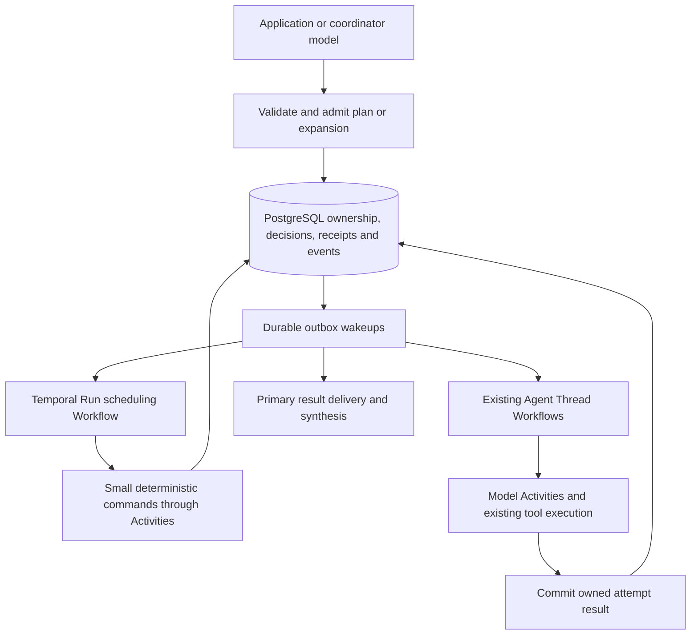

# Workflow Runs architecture plan

**Status: architecture proposal and delivery plan, 2026-10-18.** Workflow Runs are
not implemented. The maintainer requested a plan for the complete capability
before starting with a simple implementation. The first enabled operations are
a delivery subset, not the definition of the finished product. Proposed choices
below remain open to design discussion; no runtime, schema, API, or release
acceptance changes are made here.

The aim is to reuse lifecycle and execution boundaries as capabilities grow.
It is not a guarantee of zero redesign: executing arbitrary generated programs
requires a separate runtime design, and Mango's development `/v1` may change
when a better design is established. Do not preserve an early mistake through
compatibility shims or build unused frameworks to anticipate every future.

## User problem and current foundation

An application needs to submit a batch of independent tasks to selected Agents,
run a bounded number concurrently, and receive a combined answer with references
to each result. It must recover after process replacement, explain partial
failure, and let an operator stop the batch without losing committed history or
duplicating accounting for a committed model request. Manually watching child
Threads does not provide that lifecycle.

The source baseline reviewed is `49921930a2872f12b569ee027b694abbe3afb4f8`,
including `internal/pg/migrations/20261005000001_schema.sql` and
`internal/httpapi/openapi.yaml`. The existing [multi-agent workflow](../guides/multi-agent.md) is useful foundation:

| Existing Mango capability and source | Reuse and missing boundary |
| --- | --- |
| Agent Version pins and Session-owned roster snapshots; `internal/app/agent_service.go`, `internal/controlplane/session_service.go` | Freeze selected definitions for a Run; later Agent edits must not change admitted work. A plan and its admitted inputs still need their own durable identity. |
| Independent Thread history, status filters, shared usage and lifecycle; `internal/pg/session_threads.go`, `internal/pg/multiagent_runtime.go` | Reuse execution and inspection. Add explicit Run ownership, logical task identity and committed result receipts; an arbitrary child idle or latest message is not a task result. |
| PostgreSQL ledger and at-least-once outbox; `internal/pg/outbox.go` | Commit scheduling decisions with their wakeups and deduplicate delivery. Existing cursor deduplication does not by itself deduplicate Run step creation. |
| Session and Thread orchestration; `internal/temporal/session_workflow.go`, `internal/temporal/session_thread_workflow.go` | Reuse replay, timers and Activity boundaries. Add Run scheduling, joins and cancellation recovery; a Temporal Workflow execution is infrastructure, not a public Workflow Run. |
| [Deployment Runs](../api/deployments.md), `internal/domain/deployment.go`, `deployment_runs` in the schema | These record a manual/scheduled attempt to create a Session, or its creation error. They are not a phase/step scheduler inside a Session. |
| Pending actions, interrupts, Outcome evaluation, budget and content guards | Extend the existing aggregate rules to open Runs; current code has no open-Run completion or Outcome barrier. |

Relevant existing tests include `internal/pg/multiagent_runtime_test.go`,
`multiagent_lifecycle_test.go`, `multiagent_interrupt_test.go`,
`internal/temporal/session_thread_workflow_test.go` and
`internal/httpapi/session_threads_sdk_test.go`. They establish their named Thread
invariants; they do not establish Workflow Run behavior. The schema and OpenAPI
have no public Run/phase/step model for this workflow.

## Paired external reference and intentional differences

The current [CMA workflow lifecycle](https://platform.claude.com/docs/en/managed-agents/workflow-runs)
describes background programs, phases and run-owned Threads. Runs remain open
through pauses; completion requires ended Runs followed by the primary answer's
end-turn, and Outcome evaluation waits for open Runs. Budgets, client waits and
absolute lifetimes interact. Reconnection reconstructs state from durable events;
there is no Run-list endpoint, and stopping is message-driven. A completed Run
is not proof that every business task succeeded. These are useful lifecycle
inputs, not a Mango contract or evidence about CMA's internal scheduler.

The [multi-agent configuration](https://platform.claude.com/docs/en/managed-agents/multiagent-orchestration)
enables workflows with predefined and/or inline Agents; the model decides when
to start one from a request. The paired public SDKs expose configuration, typed
`workflow_run.*` events, phases/results and a `workflow_run_id` Thread relation.
They do not expose a reusable program language, scheduler implementation or
local workflow execution helper. Public phase events do not define logical
steps or execution-attempt records. Copying SDK types would not deliver an
engine.

The latest stable SDK releases were checked against the official GitHub release
and tag APIs on 2026-10-18, and the following exact source objects were read
without executing the SDKs:

| Reference | Reviewed mapping |
| --- | --- |
| [Go v1.82.0](https://github.com/anthropics/anthropic-sdk-go/tree/543d266ce81a4487281e084b013fef807dbb5f18), `543d266ce81a4487281e084b013fef807dbb5f18` | `betaagent.go`, `betasessionevent.go`, `betasessionthread.go`: configuration unions, event/result variants and Thread association. |
| [Python v1.15.0](https://github.com/anthropics/anthropic-sdk-python/tree/bcd55fe1d3f0f1240765f8cef04295b67337f55a), `bcd55fe1d3f0f1240765f8cef04295b67337f55a` | `beta_managed_agents_multiagent_workflows_enabled_params.py` and Session Run/Thread models: predefined/inline settings and typed lifecycle events. |
| [TypeScript sdk-v0.135.0](https://github.com/anthropics/anthropic-sdk-typescript/tree/04a4c28c70de498d6d0e930e43edb5edb9ac545e), `04a4c28c70de498d6d0e930e43edb5edb9ac545e` | `beta/agents/agents.ts`, `beta/sessions/events.ts`, `beta/sessions/threads/threads.ts`: settings, discriminated events and Thread mapping. |

Mango can adopt useful lifecycle and resource relationships while choosing its
own limits and operator controls. Vendor defaults, hosted credentials, preview
identifiers, model restrictions and retry counts are not Mango requirements.
CMA's [self-hosted model](https://platform.claude.com/docs/en/managed-agents/self-hosted-sandboxes)
still uses its hosted agent/control plane. Mango must own scheduling, storage,
execution and recovery. A cloud sandbox is not required to schedule Mango's own
Agents on its existing self-hosted control plane and operator workers.

## Complete target and staged availability

The Mango problem extends beyond a fixed batch. An operator should be able to
run a large review or research task, let accepted results determine subsequent
work, keep talking to the primary Agent, inspect progress, and stop the work
without losing committed results. The target below is a proposed Mango product
scope informed by the public workflows, not a claim of field-for-field CMA
compatibility or a description of its implementation.

| Capability in the complete target | Requirement the first design must accommodate |
| --- | --- |
| Sequential dependencies, parallel fanout and result joins | Model explicit step instances and dependencies. Do not hard-code two Agents followed by a summarizer or infer completion from idle Threads. |
| Model-authored plans and decisions informed by results | Separate plan production from admission and execution. Persist each accepted decision before its effects; use the same admission path for application and model requests. |
| Dynamic expansion, such as a discovered list of review tasks | Freeze each expansion's input and membership as it is admitted. A graph need not be fully expanded when its Run starts. |
| Branches, bounded loops and review/revision rounds | Separate a definition's node from each invocation and execution attempt. Persist chosen branches, iteration identities and limits consumed across the entire Run. |
| Explicit partial failure and safe business retries | Settle typed results and retain attempts. A transport retry cannot silently create a new business attempt; unknown external effects require reconciliation or an explicit decision. |
| Predefined and dynamically defined inline Agents | Give every invocation an immutable effective Agent snapshot. Predefined pins are available at Run admission; a future inline definition is fixed at its spawn admission under the Run's approved authority ceiling. |
| Several Runs and an interactive primary in one Session | Scope ownership and deduplication by Run. Deliver terminal results durably even while the primary is busy; keep Session completion distinct from an intermediate reply. |
| Budgets, approvals, deadlines, interruption and operator stop | Make these lifecycle facts shared across all operation types, rather than special cases added separately to loops or planners. |
| Progress, history reconstruction, result inspection and SDK helpers | Define one HTTP/event lifecycle, map it into all three SDKs, and rebuild state from durable history after reconnecting. |

All selected operations remain bounded by operator limits and the Session's
authority. First delivery enables a fixed-Agent dependency graph with parallel
work and synthesis. Later deliveries extend the admitted operations; they must
use the same ownership, receipts, completion and cancellation rules. Unsupported
operations are rejected before scheduling, rather than accepted as placeholder
functionality.

Arbitrary generated programs are a separate design branch. They may be useful
for the same user problems, but the bounded-plan target does not claim to cover
an unrestricted programming language. Image/PDF input and cloud sandboxes do
not become requirements of either the basic or extended plan capability.

## Proposed execution boundary

**Recommendation, pending maintainer choice:** admit a structured, bounded plan
and interpret only its validated operations in Mango's control plane. Initially
those operations are fixed-Agent fanout, join and synthesis. Model inference and
tools remain Activities or existing worker operations; Temporal code performs
trusted deterministic orchestration. Validation and execution are Mango-owned.

| Option | Benefit | Required boundary and tradeoff |
| --- | --- | --- |
| Bounded declarative plan | Durable transitions and limits can be inspected before execution; no new general code runtime. | Mango must define supported operations, typed references, bounded expansion, validation and replay semantics. It will express fewer programs than arbitrary code. |
| Program driven by an operator-owned Docker worker | Flexible libraries and arbitrary computation near operator data. | Needs isolated execution, a frozen interpreter/image/program, checkpoint and receipt protocol, lease fencing, replay behavior and external-effect recovery. Restarting a process is not resuming its program. This is a separate design and larger first slice. |

Never evaluate model-generated code in the API, orchestrator or Temporal worker
process. A Docker boundary alone does not make retries safe or establish
checkpointing; tools and generated programs may already have changed external
systems before a crash.

The control policy below proposes one admission path for application and model
starts, with deterministic inspection and stop/resume for self-hosted operators.
Exact routes, schemas and the plan-confirmation policy still need paired
API/SDK review. Prefer existing Session resources/events and standard HTTP;
CMA's message-driven control does not require Mango to depend on model calls
for operator actions. No speculative endpoint is approved by this proposal.
Inline Agent creation is part of the longer-term plan target,
outside the first slice. Arbitrary-code execution needs its own design gate.

## Proposed architecture and ownership

Use a Mango-owned Run scheduler built on the existing Temporal infrastructure,
while preserving PostgreSQL as the authority for public lifecycle decisions.
The recommended shape is one durable scheduling Workflow per Run, reusing the
existing independent Thread Workflows for Agent execution. Run ownership is a
Mango relationship; it must not depend on Temporal parent/child cancellation
semantics. Workflow code runs in Mango's orchestrator, not inside Temporal's
server or a generated-program sandbox.

Every external effect follows a committed ownership/admission decision.
Temporal replays command ordering and timers; Activities recover the same
committed decision after an acknowledgement is lost. Neither side independently
recomputes a branch or creates a second child. Carry bounded IDs, receipt
references and cursors through Workflow history and Continue-As-New; load
bounded plan fragments or results through Activities instead of transporting
the whole evolving graph.

| Boundary | Responsibility and relationship to current code |
| --- | --- |
| Plan admission and operation evaluation | Pure validation and bounded dependency/expansion rules. Keep them outside HTTP DTOs, provider adapters and Temporal-specific contexts so application and model inputs share the rules. A dedicated package is justified when those rules are implemented, not as an empty plugin framework. |
| PostgreSQL transitions | Own Run, instance, attempt, expansion membership and receipt identity; commit state, events and outbox atomically. Extend `internal/pg` with the same Session-first lock order and no external I/O in transactions. |
| Temporal adapter | Add Run scheduling, timers and receipt-driven wakeups beside `SessionWorkflow` and `SessionThreadWorkflow`. Retain their Agent execution loop rather than building another model/tool runner. |
| Existing Thread completion and Session aggregation | Run-owned child results settle their Run's receipt; ordinary subagent reports retain their coordinator workflow. Extend completion, Outcome, pending-action, deletion and Work-idle checks coherently. |
| Existing operator worker | Continue Environment Work leases, scoped credentials, Skills/Memory preparation and serial local tools. Stopping one Run must not stop the shared Work item or unrelated Threads. |
| Public contract and clients | HTTP DTOs and OpenAPI describe Mango's Run lifecycle; generated clients and handwritten observation helpers compose that lifecycle in Go, Python and TypeScript. Server scheduling state does not leak into client internals. |

### Definitions, instances and decisions

The immutable accepted plan describes operations and references. A Run binds
that definition to admitted inputs, Agent pins, authority and limits. A logical
step instance is one invocation of a definition's node; an attempt is one
execution of that invocation. A receipt is the committed result of that attempt.
Phase names group progress and are not dependency edges or step identity.

Run creation freezes the plan revision, known inputs, predefined pins and
authority ceiling. It does not pre-expand the entire future graph. A later
expansion validates committed inputs, selects stable parent/iteration/item
identities, and freezes the resulting instances or inline Agent definitions
before dispatch. Replaying the same expansion returns that decision. The same
Agent may appear in many instances; neither its name nor Thread ID alone is a
logical task identity. Do not add unused loop or inline-Agent tables in the
first implementation merely because these concepts have a place in the plan.

A join consumes an explicitly closed membership set. For example, completing
the first page of discovered tasks cannot satisfy a join while the producer
still has another page to admit. Persist each producer's input snapshot/order,
expansion identity, admitted members and closed/sealed decision; a late receipt
or retried decision cannot mutate a closed set. A fixed first-profile graph
already has closed dependency sets and uses this same rule. A producer failure
before closure is a failure or explicitly declared partial closure, never a
successful seal inferred from its currently completed children.

Result references identify immutable committed values, Thread/event receipts,
or authorized Files whose retention is protected while referenced. A mutable
path in the shared sandbox is not a replayable result value: another Agent or
Run can modify it. The first profile can use bounded text/event receipts without
depending on automatic Files output publication. A future output snapshot must
use explicit scoped publication rather than snapshotting the whole workspace.

## Proposed durable model and acceptance invariants

These are requirements to validate in the selected design, not implemented
fields or an approved schema:

| Concept | Durable responsibility |
| --- | --- |
| Plan definition | Immutable accepted revision and supported operations; separate from model planning attempts and the graph expanded during execution. |
| Run | Session/Workspace owner, accepted definition, known pins and inputs, approved permission ceiling, cumulative limits, absolute deadline, usage and terminal result. |
| Phase | Stable progress grouping. A phase-end event alone must not imply successful task completion or a satisfied join. |
| Step instance | A stable invocation of a definition node, including its admitted parent/iteration/item identity when applicable, dependencies and bounded input references. |
| Execution attempt | A distinct attempt/generation, owning child Thread, execution state and settlement receipt. Transport retry must not silently become a new business attempt. |
| Expansion decision | Frozen producer inputs, selected branch or members plus explicit closure state; commit each decision once before its child effects. Added when dynamic expansion is enabled. |
| Result reference | A committed step/attempt receipt referring to owned Thread/events or authorized immutable Files, with bounded summary and explicit success/failure. References must retain their bytes and authorization while consumed. |

1. **Atomic ownership and delivery.** Commit each admission, spawn decision or
   result settlement with its ownership rows, public events and required outbox
   intent under consistent Session-first transaction locks. No model, worker or
   object-store I/O belongs inside those transactions. Crash between SQL commit
   and signal delivery must recover. Replayed scheduling must not spawn another
   child for the same committed logical attempt or settle a join twice.
2. **Complete the owned work.** A Run owns its child lifecycle and accepts each
   result only for the expected step and attempt. Joins consume settled receipts,
   including explicit failures. Terminalizing a Run must fence future spawn,
   settle or cancel its owned children and pending actions, and emit one terminal
   result without modifying unrelated ordinary Threads.
3. **Open-Run barrier.** No primary final completion or Outcome grading may
   treat an open Run as finished, including during budget or approval waits.
   Terminal results must be delivered durably to the primary synthesis turn.
   Only after required Run results are consumed and synthesis completes may the
   aggregate report final end-turn or start grading. Run completion and task
   quality remain separate facts. Work idle retirement must check this expanded
   aggregate too; an apparently quiet Thread is insufficient.
4. **Cancellation and late arrivals.** Define Run stop separately from targeted
   Thread interrupt and Session-wide interrupt; do not silently reinterpret
   current Mango interrupts. Cancel-versus-result, cancel-versus-spawn and
   timeout-versus-join need a transactional winner. Late receipts cannot reopen
   a terminal Run. Reported usage from already-started calls remains accountable
   once per request identity even after logical termination; this does not
   guarantee a provider charged only once. Archive/delete and Agent repinning need
   explicit, atomic admission rules.
5. **Bounded waiting and spending.** Fix concurrency, total expanded steps,
   attempts, result size and an absolute deadline at admission. Approval waits
   remain open and cannot become implicit approval or success. Pauses must not
   silently extend the deadline; define how budget changes resume only eligible
   work. Enforce Session-wide as well as per-Run concurrency/expansion limits;
   several individually bounded Runs must not bypass the Session limit. Recheck
   the persisted deadline when admitting effects or accepting results, even if
   a Temporal timer is delayed by an outage. Reuse existing model-request admission and accounting rather
   than inventing a second Run quota ledger. Concurrent model requests can
   overshoot a usage budget; bound admission and account actual usage without
   promising an exact cap after inference. A Run subtotal must state which
   planner/child/synthesis calls it includes; Session usage remains authoritative.
6. **Side effects and retries.** Infrastructure retries reuse committed identity.
   A failed child is not automatically safe to run again on a new Thread.
   Explicit business retry policy must distinguish definite failure from an
   unknown external effect, retain prior attempts, and require idempotent tool
   keys or reconciliation. Initial delivery may fail the Run instead of retrying
   an ambiguous task automatically.
7. **Payload and access limits.** Use small scheduling metadata and existing
   durable result references; do not accumulate full batch outputs in Temporal
   history or bypass the [runtime content limit](../api/events.md#runtime-content-capacity).
   Measure actual encoded Activity/completion payloads. Enforce Workspace and
   Session ownership, immutable pins, permission ceilings and worker leases on
   every expansion/result path. A plan cannot widen credentials or tool policy.
8. **Observable recovery.** Durable event history must reconstruct Runs, phase
   progress and owned children after disconnection. Use subscribe-before-history
   and ID deduplication. Events, errors and SDK variants must distinguish waiting,
   partial failure and terminal results without exposing prompts or credentials
   in diagnostics. Metadata-only tracing complements this ledger; it does not
   replace durable receipts.

Keep PostgreSQL as the source of lifecycle truth and Temporal as the durable
orchestrator. Reuse existing Thread execution rather than implement another
agent loop. New Run state must extend the current admission, pending-action,
Outcome and idle-retirement decisions coherently; adding a Thread field or a new
Temporal Workflow name alone does not satisfy these invariants.

## Proposed lifecycle and public-control policy

These are recommended semantics for discussion, not changes to today's API.
They must be settled and tested with the first runtime slice rather than left
to each later operation's interpretation.

| Situation | Proposed behavior |
| --- | --- |
| Start acknowledgement is lost | Reuse a durable admission command identity bound to Workspace, Session and the canonical request. Same identity/input returns the same Run; different input conflicts. Retain that record while the Run exists. Model-start commands derive identity from their committed tool invocation. A public create needs a documented retry identity before release; current Session event submission does not supply generic create idempotency. Do not confuse a tracing request ID with a deduplication key. |
| Primary chat or several Runs | Permit primary conversation and bounded concurrent Runs. Run terminal events queue durable, individually identifiable result deliveries for the existing primary loop, including while it is busy. Commit consumption with the corresponding primary turn; replay does not deliver the same committed result twice. |
| Aggregate completion and Outcome | Initially use a Session-wide barrier: all open Runs must end, required terminal deliveries must be consumed, and normal primary/pending-action conditions must permit completion. Check and publish this under the Session lock, serialized with new Run admission. Intermediate primary replies do not imply aggregate final end-turn. Per-message completion wait sets are a separate future API decision. |
| Child report | A Run-owned child settles its expected attempt and wakes its Run scheduler; do not automatically wake the primary once for every child as ordinary subagent reports currently do. Terminal Run delivery wakes synthesis. Reject ordinary follow-up or archive operations that bypass an open Run's ownership. |
| Approval or budget wait | Keep the Run open and record its wait conditions. One step's approval wait must not block unrelated runnable steps or other Runs. A Run is idle only when none of its owned work can progress; waiting steps can coexist with a running Run. Blocking conditions may coexist: lifting the budget cannot clear an interrupt pause or unanswered approval. Waits do not extend the absolute deadline. Existing tool allow/ask/deny semantics remain in force. |
| Run stop or deadline | Atomically fence new expansion, child admission and business-result acceptance, close owned logical tasks/pending barriers, and commit a single terminal result plus scoped cleanup intents. Inspection must distinguish logical termination from outstanding physical cleanup. Existing external effects are not rolled back. |
| In-flight call after stop | Cancel through existing scoped mechanisms where available; bound and reconcile remaining cleanup. Late business results cannot reopen the Run or start a join, but late reported usage is settled once. Never stop the shared Environment Work item to cancel one Run. Verify actual per-Thread tool cancellation behavior before advertising physical-stop guarantees. |
| Session-wide interrupt and resume | Preserve ordinary Thread interrupt behavior while additionally pausing open-Run scheduling and interrupting their active turns. Record the pause durably. An ordinary new message may run the primary but does not implicitly authorize resuming every Run; explicit Run resume clears only the relevant pause on a nonterminal Run and still respects budget, approval and deadline. Stop/deadline terminalization cannot be reversed by resume; new work requires explicit new admission. |
| Archive/delete the Session or replace/repin its Agent while a Run is open | Reject with a diagnostic conflict even if the aggregate is idle at a budget/approval wait. Operators stop Runs first. This guard concerns the Session, not a ban on updating the underlying saved Agent to a new version; admitted snapshots remain unchanged. After Runs settle, use existing archive or fenced prepare/terminate/finalize deletion; referenced results remain protected until their owning lifecycle releases them. A future combined stop-and-delete operation needs its own atomic design. |
| Dynamically defined inline Agent | Validate and freeze its effective definition at spawn admission under the Run's approved authority ceiling. That ceiling may explicitly include predefined Agent capabilities different from the primary's. Snapshot model, prompt, tools, policies, MCP/Skill bindings and Memory access; retain credential references, never plaintext secret snapshots. Rotation/revocation and live operator policy still apply. |

Application and model starts should share admission, inspection, deterministic
stop/resume and event semantics. Operator control must remain usable when the
model or a budget is unavailable. Prefer a Session-owned Run resource and the
existing event ledger; exact route spelling and schemas belong in the first
implementation's paired HTTP/OpenAPI/SDK review. Propose no new vendor headers,
provider preview identifiers or compatibility namespace. Go, Python and
TypeScript must expose the same operation grouping, typed results, pagination
and reconnect lifecycle, regardless of generator convenience.

## Design checks against future rework

| Future scenario | Design requirement to prove early; implementation can remain incremental |
| --- | --- |
| The same Agent runs twice, then a loop repeats it | Node definition, instance and attempt identities are distinct. First-profile acceptance must invoke one Agent in several logical steps; enabling loops adds admitted iteration instances, not a new meaning for the old deduplication key. |
| A result discovers a second page of tasks | Join membership is closed explicitly; the scheduler cannot declare success between pages. Dynamic producer and seal storage lands with that feature, not as unused first-profile tables. |
| R2 completes while R1 runs and the user asks for progress | Results queue independently, the primary can answer, and the Session-wide completion/Outcome barrier stays closed. Test this without a global singleton Run slot. Limits may constrain admission, but ownership is always per Run. |
| Run stop commits while a model/tool finishes | Separate logical fencing, cancellation delivery, physical cleanup and accounting. Prove late usage is retained without accepting a successful business result or terminating another Run's tools. |
| A planner returns but the reply is never committed | Reuse a committed planning receipt whenever it exists. An unknown/uncommitted response cannot be recovered by assertion: a bounded new planning attempt may be required, with its own accounting. No child may execute an unadmitted plan. |
| A future inline Agent requests new MCP credentials | Its effective snapshot fits already-approved Run authority. Reject escalation; keep live credential rotation and revocation rather than freezing secret values at Run creation. |
| Two Runs access the same workspace path | The filesystem remains shared and mutable. Use committed values or immutable snapshots for dependency inputs. Do not claim Agent/Run isolation or introduce tool parallelism through a plan-language feature. |
| A future executable program calls a library with direct I/O | A replaceable interpreter interface is insufficient. Program memory/control state, nondeterminism, direct effects, concurrency and checkpoints need a distinct design. Reuse ownership/accounting/Agent-command boundaries where valid; do not promise a drop-in executor swap or zero redesign. |

Before the first implementation is finalized, write the exact admitted plan
profile, retry-identity contract, transition/lock rules, resource limits and
raw HTTP/event examples. Review these against the scenarios above. Later
deliveries may change `/v1` and storage directly when justified; extensibility
does not create a requirement to keep a poor early schema forever.

## Proposed end-to-end PR groups

Plan the complete lifecycle first, then enable these capabilities incrementally.
A group may require several focused PRs for safe review; this is not a promise
of full CMA behavior in five PRs. No public endpoint, feature flag or SDK type
should advertise an operation before its runtime and recovery path exists.

### 1. Durable fixed-Agent dependency graphs

Deliver one usable operator journey: admit a small fixed graph, run independent
Agent steps concurrently, join committed receipts, and synthesize the result.
Use the real definition/instance/attempt model and dependency rules rather than
special-case batch code. Implement start retry identity, inspection, deterministic
stop/resume, events, cumulative limits and result delivery in this same slice.
No model-generated plan, dynamic expansion, branches, loops or inline Agents.

The first slice reuses the Session's shared sandbox and filesystem. Concurrent
model turns or Threads do not imply concurrent local tools, a separate filesystem
per Agent, or Agent/Run isolation. Keep the current Go worker behavior:
`EnvironmentWorker` composes one `SessionToolRunner` for the Session, whose
dispatch loop executes local tools serially. Parallel tools or per-Agent
sandboxes require separate file-conflict, effect, resource and isolation design.

Acceptance includes raw HTTP and all SDKs, duplicate/lost start replies,
Workspace isolation, frozen inputs/pins, one Agent used in distinct steps,
parallel success, explicit child failure, approval/budget waits, stop/timeout,
late results and late usage, and Work lease reclaim. Exercise two Runs and
primary progress messages so completion and ownership are not singleton
assumptions. Real PostgreSQL/Temporal tests lose replies or replace processes
at admission, spawn, receipt, join, result delivery and terminalization; prove
no duplicate committed child, receipt consumption or request accounting.
Inspect worker cancellation behavior and expose only guarantees it can prove.

### 2. Model-generated admitted plans

Let the primary propose supported operations through normal model tool calling;
application and model plans use the same validator, admission identities and
scheduler. Commit the accepted proposal, inputs and plan before scheduling.
Choose and document explicit plan confirmation or preauthorized admission under
a Run capability policy; tool approvals continue independently. Do not expose
an option whose name silently grants broader tools, credentials or spend.

Acceptance includes invalid references, cycles in a static dependency graph,
malformed/oversized plans, unknown Agents, authority escalation, exceeded limits,
confirmation denial and proposal changes. Reuse committed planning receipts on
recovery. If the provider reply was not committed, record any new planning
attempt honestly; no unadmitted result may execute, and no lost reply is assumed
to be recoverable. Cover planner usage, rejection events and the same first-group
completion/cancellation path. No arbitrary generated code.

### 3. Result-driven expansion and sealed joins

Allow an admitted producer to expand a bounded list of task instances from
committed results, then close its membership. Persist its input snapshot/order,
expansion identity, members and seal. Resolve dependencies through typed result
references rather than model text or mutable workspace paths. Cumulative work
and size limits include every page and attempt, not only currently active tasks.

Acceptance includes duplicate input values, paged discovery, restart before and
after seal, child results arriving before producer closure, duplicate expansion
commands, limit exhaustion, cancellation during admission and membership that
cannot change after seal. Prove no premature join and no repeated committed
spawn. Add only the expansion storage/rules now exercised by this feature.

### 4. Bounded control flow and explicit failure/retry policies

Add selected branch predicates and bounded review/revision loops using the same
admission and receipt model. Each invocation/iteration gets stable instance
identity. Persist decisions before their effects; a replay cannot select a new
branch. Joins follow the admitted selected branch, with unchosen work explicitly
skipped or excluded by that decision, rather than waiting on nonexistent steps.
Choose fail-fast versus explicitly collected partial failures, sibling
cancellation, and safe attempt/backoff rules. Keep unknown-effect repair separate
from ordinary infrastructure retry.

Acceptance includes multi-iteration replay, loop exhaustion, nested expansion
bounds, branch decisions at cancellation, partially joined failures, budget and
approval pauses, stale prior-attempt results and actual-incurred usage. Test
cumulative limits across all iterations. Do not enable unbounded recursion,
hidden business retries or a general language interpreter through this step.

### 5. Inline Agent snapshots under admitted authority

Allow the plan/model to propose an effective inline definition at a spawn
boundary. Validate it against the Run's approved model/tool/MCP/Skill/Memory
scope, then snapshot it and bind it to the instance before execution. Reuse the
same Agent execution and attempt lifecycle as predefined Agents; later changes
to a prompt or definition do not rewrite an admitted instance.

Acceptance includes definition reply loss, duplicate spawn, unauthorized model
or tool/MCP changes, Skill pin drift, credential rotation/revocation after
snapshot, Memory access, restart and late results. Keep credential references
and live operator controls; do not freeze plaintext secrets or infer permission
from model-authored text. No per-Agent filesystem isolation is implied.

### Separate gate: executable generated programs

Revisit this only with a selected user scenario that the admitted operations do
not serve adequately. Compare extending bounded operations with a separately
isolated program runtime. A program route needs frozen code/image/interpreter,
a durable command/checkpoint protocol, control-state recovery, nondeterminism
capture, direct-I/O authority, leases and ambiguity repair. A container restart
and an interpreter interface do not establish those properties. Prototype crash
and effect boundaries before promising interchangeability with plan execution.
Reuse the existing lifecycle/Agent-command boundaries where sound; expect an
additional runtime and possible schema/API changes if this route is selected.

Every implementation group updates affected HTTP validation, OpenAPI,
Go/Python/TypeScript client mappings, independent raw HTTP and SDK conformance,
API/capability docs and owning PostgreSQL/Temporal recovery tests together.
Observation helpers and examples must use the same public completion and
reconnect rules; do not make the SDKs independently interpret task success.
Add service/operator Docker coverage when worker execution changes and record
an available real-model smoke separately. This documentation does not establish
execution, failure-recovery or provider-quality evidence for any future group.

## Separate self-hosted follow-ups

These candidates solve independent user/operator problems. Each needs its own
selected scope and acceptance; they are neither prerequisites for basic bounded
fanout nor an automatic parity backlog.

| Candidate | Existing capability and a bounded next acceptance |
| --- | --- |
| Opt-in metadata-only OTel | Current lifecycle logs and model/Outcome span events are not first-party Work/tool OTel tracing; indirect OTel dependencies do not supply that feature. Start with caller-supplied tracing for Go worker Work/tool lifetimes, including direct `HandleItem`, cancellation and lease loss. Keep tool arguments/results, prompts, credentials and arbitrary baggage out by default. Decide propagation/exporter separately. See the [official self-hosted tracing reference](https://platform.claude.com/docs/en/manage-claude/opentelemetry/sdk). |
| Recoverable File/Git preparation and controlled Files outputs | Operator staging and explicit immutable File upload already work. A helper could freeze checksums/commits and relative destinations, avoid overwriting local work on recovery, and publish only operator-allowed paths under scoped authority. Test interrupted/unknown uploads, size/hash checks, credential narrowing and lease loss; never put a Workspace key in a tool container. |
| Repository Skills import | Validated bundles and immutable Skill pins already exist. Import explicitly selected paths at a fixed repository commit with path/symlink/conflict checks, then reuse existing validation and pins. Avoid implicit repository-wide trust. |
| Provider-enforced Web policy | Mango supports provider-native Web with fixed permission requirements. Admit domain restrictions only when the selected provider actually enforces them; fail closed when unsupported and allow child policies to narrow only. Do not advertise prompt instructions as network enforcement. |
| OAuth permanent-refresh failure | Refresh, validation and rotation fencing already exist. Add a durable permanent-failure transition and one notification, separating transient errors and fencing stale credential generations. Test rotation races and redact secrets. |
| Operator-private MCP policy | Public-address SSRF rejection is the correct default. A separate operator policy could allow narrow hosts/ports or use a worker custom-tool bridge, with explicit DNS/redirect/network and credential boundaries. No blanket SSRF bypass or hosted tunnel dependency. |

The official [self-hosted resource guide](https://platform.claude.com/docs/en/managed-agents/self-hosted-sandboxes#session-resources)
currently rejects `file` and `github_repository` Session resources with `400`
and directs operators to host staging; its worker prepares Skills and Memory.
Cloud mounting/output behavior is not the baseline for self-hosted parity.
Recoverable staging and scoped publication are still worthwhile Mango developer
experience improvements when independently selected. Normal deliverables must
also be distinguished from Mango's existing generated MCP File publication.

Image/PDF model input, cloud sandbox providers and experimental external-state
cold restore are outside this proposal's implementation groups and follow-ups.
They do not block selecting a self-hosted Workflow Run design.
