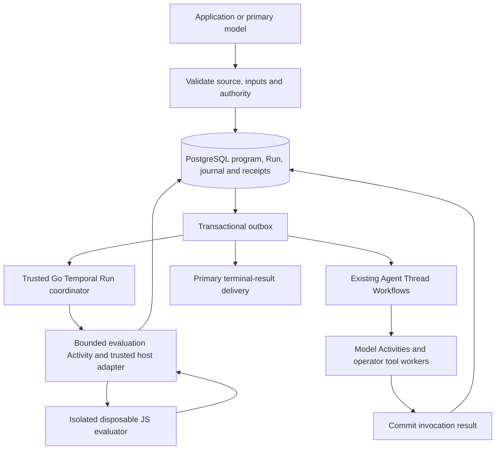

# Workflow Runs architecture plan

**Status: revised architecture proposal and delivery plan, 2026-10-19.** Workflow Runs are
not implemented. The maintainer requested a plan for the complete capability
before starting with a simple implementation. The first enabled operations are
a delivery subset, not the definition of the finished product. Proposed choices
below remain open to design discussion; no runtime, schema, API, or release
acceptance changes are made here.

This revision supersedes the proposed declarative-plan-first direction. The
recommendation is a restricted JavaScript orchestration program, independently
implemented by Mango, rather than a public JSON DAG language expanded one node
type at a time. JSON still carries data, metadata and host commands. This choice
is informed by newly reviewed official demonstrations; it does not assert that
CMA's unpublished execution engine is JavaScript or uses Temporal/PostgreSQL.

The [program execution and recovery design](workflow-program-runtime.md) defines
the proposed JS/Temporal/PG protocol, context boundaries and failure cases.
Engine, isolation packaging and async replay feasibility must be resolved before
product implementation. The aim is reusable lifecycle boundaries, not a promise
of zero redesign or an excuse to build unused infrastructure. Mango may change
development `/v1` directly when a better design is established.

## User problem and current foundation

An application needs to submit a batch of independent tasks to selected Agents,
run a bounded number concurrently, and receive a combined answer with references
to each result. It must recover after process replacement, explain partial
failure, and let an operator stop the batch without losing committed history or
duplicating accounting for a committed model request. Manually watching child
Threads does not provide that lifecycle.

The source baseline reviewed is `2f53b8e633055cdf50abb7cdd334a33264d109d7`,
including `internal/pg/migrations/20261005000001_schema.sql` and
`internal/httpapi/openapi.yaml`. The existing [multi-agent workflow](../guides/multi-agent.md) is useful foundation:

| Existing Mango capability and source | Reuse and missing boundary |
| --- | --- |
| Agent Version pins and Session-owned roster snapshots; `internal/app/agent_service.go`, `internal/controlplane/session_service.go` | Freeze selected definitions for a Run; later Agent edits must not change admitted work. Program source, runtime profile and admitted inputs still need durable identity. |
| Independent Thread history, status filters, shared usage and lifecycle; `internal/pg/session_threads.go`, `internal/pg/multiagent_runtime.go` | Reuse execution and inspection. Add explicit Run ownership, logical task identity and committed result receipts; an arbitrary child idle or latest message is not a task result. |
| PostgreSQL ledger and at-least-once outbox; `internal/pg/outbox.go` | Commit scheduling decisions with their wakeups and deduplicate delivery. Existing cursor deduplication does not by itself deduplicate Run step creation. |
| Session and Thread orchestration; `internal/temporal/session_workflow.go`, `internal/temporal/session_thread_workflow.go` | Reuse replay, timers and Activity boundaries. Add Run scheduling, joins and cancellation recovery; a Temporal Workflow execution is infrastructure, not a public Workflow Run. |
| Ordinary child reports and current Messages adapter; `internal/pg/thread_completion.go`, `internal/model/anthropic.go` | Last-message reporting and effort configuration are not schema-validated program results. Add an explicit owned terminal-return adapter and trusted validation before journal delivery. |
| [Deployment Runs](../api/deployments.md), `internal/domain/deployment.go`, `deployment_runs` in the schema | These record a manual/scheduled attempt to create a Session, or its creation error. They are not a phase/step scheduler inside a Session. |
| Pending actions, interrupts, Outcome evaluation, budget and content guards | Extend the existing aggregate rules to open Runs; current code has no open-Run completion or Outcome barrier. |

Relevant existing tests include `internal/pg/multiagent_runtime_test.go`,
`multiagent_lifecycle_test.go`, `multiagent_interrupt_test.go`,
`internal/temporal/session_thread_workflow_test.go` and
`internal/httpapi/session_threads_sdk_test.go`. They establish their named Thread
invariants; they do not establish Workflow Run behavior. The schema and OpenAPI
have no public Run/phase/step model for this workflow.

## Paired external reference and intentional differences

The current [CMA workflow lifecycle](https://platform.claude.com/docs/en/managed-agents/workflow-runs)
describes background programs, phases and run-owned Threads. Runs remain open
through pauses; completion requires ended Runs followed by the primary answer's
end-turn, and Outcome evaluation waits for open Runs. Budgets, client waits and
absolute lifetimes interact. Reconnection reconstructs state from durable events;
there is no Run-list endpoint, and stopping is message-driven. A completed Run
is not proof that every business task succeeded. These are useful lifecycle
inputs, not a Mango contract or evidence about CMA's internal scheduler.

The [multi-agent configuration](https://platform.claude.com/docs/en/managed-agents/multiagent-orchestration)
enables workflows with predefined and/or inline Agents; the model decides when
to start one from a request. The paired public SDKs expose configuration, typed
`workflow_run.*` events, phases/results and a `workflow_run_id` Thread relation.
They do not expose a reusable program language, scheduler implementation or
local workflow execution helper. Public phase events do not define logical
steps or execution-attempt records. Copying SDK types would not deliver an
engine.

The official Cookbook repository's current main was checked on 2026-10-19:
`a162e0184e71b60290808a43961a6cbc8060123c` (2026-10-17). This materially
changes the earlier research: there are concrete program demonstrations, even
though the CMA client types do not contain the server executor.

| Public demonstration | Evidence and Mango consequence |
| --- | --- |
| [Agent SDK dynamic-workflow notebook](https://github.com/anthropics/claude-cookbooks/blob/a162e0184e71b60290808a43961a6cbc8060123c/claude_agent_sdk/08_Dynamic_workflows.ipynb), especially the saved output of `show_script(factcheck_info)` | A complete generated JS program extracts claims, verifies in parallel, conditionally calls skeptics and assembles a report. JSON schemas describe Agent outputs; they are not the orchestration language. Intermediate values stay in program variables. Adopt this separation, not its implementation. |
| [CMA security-review notebook](https://github.com/anthropics/claude-cookbooks/blob/a162e0184e71b60290808a43961a6cbc8060123c/managed_agents/CMA_agent_security_review.ipynb), `review_settings`, `review_message`, and `answer_tool_calls_until_idle` | Explicitly enables workflows and disables ordinary subagents. Parallel per-session review precedes a reporting phase; custom tools validate submitted verdicts. Its event loop waits for ended Runs and final end-turn. This is an actual CMA integration; it does not expose the generated program or prove its engine/language. Its cloud Environment configuration is not a Mango requirement. |
| [Claude Code script, isolation and recovery documentation](https://code.claude.com/docs/en/workflows) | Publicly describes restricted JS, no direct filesystem/shell/import, script variables, saved scripts and replay of Agent results. Adopt a narrow orchestration capability. Change resume semantics for Mango: pin immutable code, check the full command/delivery trace, and do not automatically rerun a completed suffix after code changes. |

The notebooks and saved outputs were read as research, not executed. The local
`08_Dynamic_workflows.ipynb` at reference checkout
`d7265d6ae994ccd8429db0594b000073b2f9ad43` matches the reviewed current file
byte-for-byte; the new CMA security-review example was read at the pinned commit
above. Public materials still do not establish CMA's interpreter, storage or
server recovery protocol. The JS/PG/Temporal design below is Mango's proposal.

The latest stable SDK releases were rechecked against the official GitHub
release/tag APIs on 2026-10-19; they remain the versions below. Exact source
objects were read without executing the SDKs:

| Reference | Reviewed mapping |
| --- | --- |
| [Go v1.82.0](https://github.com/anthropics/anthropic-sdk-go/tree/543d266ce81a4487281e084b013fef807dbb5f18), `543d266ce81a4487281e084b013fef807dbb5f18` | `betaagent.go`, `betasessionevent.go`, `betasessionthread.go`: configuration unions, event/result variants and Thread association. |
| [Python v1.15.0](https://github.com/anthropics/anthropic-sdk-python/tree/bcd55fe1d3f0f1240765f8cef04295b67337f55a), `bcd55fe1d3f0f1240765f8cef04295b67337f55a` | `beta_managed_agents_multiagent_workflows_enabled_params.py` and Session Run/Thread models: predefined/inline settings and typed lifecycle events. |
| [TypeScript sdk-v0.135.0](https://github.com/anthropics/anthropic-sdk-typescript/tree/04a4c28c70de498d6d0e930e43edb5edb9ac545e), `04a4c28c70de498d6d0e930e43edb5edb9ac545e` | `beta/agents/agents.ts`, `beta/sessions/events.ts`, `beta/sessions/threads/threads.ts`: settings, discriminated events and Thread mapping. |

Mango can adopt useful lifecycle and resource relationships while choosing its
own limits and operator controls. Vendor defaults, hosted credentials, preview
identifiers, model restrictions and retry counts are not Mango requirements.
CMA's [self-hosted model](https://platform.claude.com/docs/en/managed-agents/self-hosted-sandboxes)
still uses its hosted agent/control plane. Mango must own scheduling, storage,
execution and recovery. A cloud sandbox is not required to schedule Mango's own
Agents on its existing self-hosted control plane and operator workers.

## Complete target and selected recommendation

An operator should be able to run a large review or research task, let results
determine subsequent work, keep talking to the primary Agent, inspect progress,
and stop it without losing committed results. The proposed target is a program
that coordinates Agent invocations, not an unrestricted application runtime.

| Part of the design | Decision and rationale |
| --- | --- |
| User problem | Batch research, verification, revision and synthesis need repeatable control flow without putting every intermediate result in the primary model context. |
| Durable lifecycle | Preserve accepted code/inputs, invocation identity, result delivery, waits, stop and accounting through process loss. These facts are not delegated to a model's memory or a JS heap. |
| Hosted/vendor constraints | Reject hosted scheduling, cloud sandbox dependency, provider headers, fixed model choices and vendor retry counts. Mango owns its control plane and operator workers. |
| Wire and language choices | Recommend restricted JS plus ordinary JSON inputs/results and existing Mango Session/event primitives. Exact API/helper shapes remain Mango-owned and require paired HTTP/SDK design. |

**Recommendation, subject to the feasibility gate:** use JS for sequential,
parallel, result-driven branch/loop and transformation logic; use a small
Mango-owned host API for all effects. Do not first ship a JSON DAG interpreter
and assume a later JS engine will be a free replacement. Initial implementation
can certify fewer host operations without inventing a second plan language.

The complete target includes predefined and inline Agent invocations, several
Runs with an interactive primary, bounded pipelines and iterations, explicit
partial failure/retries, progress and inspection. All operations obey Run and
Session authority, capacity and deadline limits. Ordinary `if`/loops are code;
new host operations require their own recovery/permission contract. File I/O,
networking, packages, arbitrary processes and unrestricted Node applications
are outside this program profile. Image/PDF input and cloud sandboxes remain
independent, deferred capabilities.

## Proposed architecture and ownership

| Owner | Responsibility | Does not own |
| --- | --- | --- |
| JS program | Compute prompts, arrays, result transformations, branches and iterations; request approved Agent work. | Database access, tools, credentials, wall-clock scheduling, durable truth or LLM transcript compaction. |
| PostgreSQL | Immutable source/input/runtime pins; ordered program command/delivery journal; invocation/attempt ownership, results, lifecycle, events and outbox. | A serialized live JS stack or an independent unjournaled scheduler. |
| Temporal Go coordinator | Durable wakeups, bounded evaluation Activities, timers, reconciliation and Continue-As-New. | Running generated JS inside Workflow code or storing all source/results in history. |
| Isolated evaluator and trusted host adapter | Execute a bounded program slice, reconstruct its variables from the journal, validate/commit host requests and yield on durable waits. | Another model/tool runner, the Session sandbox, or authority to widen Run permissions. |
| Existing Thread execution | Per-Agent model context, provider/tool loop, pending actions, usage and effect journal. | Deciding that child idle means a program invocation has returned a valid result. |
| Existing operator worker | Environment Work leases, tool execution, workspace, Skills and Memory. | Running the JS scheduler as an ordinary Bash tool or isolating each Agent's shared filesystem. |

The evaluator has a separate trust boundary but need not become a new public
service or SDK dependency. Installation/packaging is decided at the gate.
Mango's architecture should add a narrow program host/journal boundary, extend
`internal/pg` transitions and the existing Temporal adapter, and reuse Agent
execution. Do not add interfaces around every DTO or build a pluggable universal
workflow framework. The [detailed protocol](workflow-program-runtime.md) owns
lease fencing, Promise ordering, replay cost and the runner containment gate.

One Temporal scheduling Workflow per Run remains the recommendation. This is
infrastructure, not the public Run itself; its parent/child cancellation policy
cannot substitute for Mango ownership. Existing Workflows carry some complete
turn DTOs under current limits; the new program pump must use IDs and bounded
decision references from the start rather than multiplying those payloads.

### Definitions, invocations and recovery

A Run binds one immutable program revision to admitted inputs, Agent snapshots,
authority and limits. An invocation is one observed `agent()` call, including a
repeated identical call or loop iteration; an attempt is its explicit execution
attempt. Phase names are progress labels, not dependency or task identities.

Future work is discovered by running the code over committed results. Freeze
each invocation's actual prompt, Agent definition and schema before dispatch.
The program journal records host-call order and result-delivery order; pure
branches replay from those facts rather than requiring a separate JSON branch
node/table for every `if`. Static whole-program validation cannot know every
future prompt, loop count or effect, so host admission enforces bounds at every
call. Unknown/forbidden capabilities fail before their effects.

JS variables are transient. A fresh evaluator reruns the pinned code and reads
matching committed outcomes at recorded scheduler turns. That reconstructs
ordinary variables without repeating committed Agent work. A changed trace
fails closed. Temporal independently replays its trusted coordinator commands.
Neither a container restart nor successful Temporal replay proves JS recovery.

A join must have a closed membership, not infer completion from currently idle
or completed children. A parallel helper freezes its ordered members; paged or
pipeline expansion must close each membership under its defined host contract.
Finishing one page does not imply producer completion, and producer failure is
not a successful seal. Store grouping only when that helper is implemented;
the fundamental records are invocations and the program trace.

Result references identify immutable receipts/values or authorized retained
Files. A mutable sandbox path is not a replayable value. All Agent Threads still
share the Session filesystem; concurrent model work does not imply concurrent
local tools. Current `EnvironmentWorker` uses one `SessionToolRunner` per Session
and dispatches local tools serially. Program orchestration does not change that.

### Context ownership

The primary owns the user conversation and reads bounded Run progress/results.
Each invocation owns an independent Thread with its exact admitted prompt,
selected upstream inputs and its own provider transcript. The program owns
intermediate values, reconstructed from immutable inputs/receipts. PG owns the
execution facts and Temporal owns durable scheduling. These are distinct forms
of state; none can be replaced by a summary of the primary conversation.

Existing working-turn admission, token estimates and preparation compaction
apply to planner/child/synthesis model calls. Original history remains retained.
Program journals and committed results are not compacted as chat. Large-data
summarization, if needed, is an explicit accounted invocation. Full request audit
snapshots for every round and equivalent Outcome/Advisor overflow recovery are
not supplied by this design. The [context section](workflow-program-runtime.md#context-and-data-movement)
defines exact input retention, bounded hydration, untrusted data and source
inspection requirements.

## Proposed durable model and acceptance invariants

These are requirements to validate in the selected design, not implemented
fields or an approved schema:

| Concept | Durable responsibility |
| --- | --- |
| Program definition | Exact accepted source, digest, inert metadata and pinned engine/helper/platform profile; separate from the model attempt that proposed it. |
| Run | Session/Workspace owner, immutable program/input/pins, approved permission ceiling, cumulative limits, absolute deadline and terminal result. |
| Phase | Stable progress grouping; phase-end does not imply business success or satisfied joins. |
| Invocation | A stable observed program call with exact task, output contract and effective Agent snapshot. Repeated calls have distinct Run-local identities. |
| Execution attempt | Owning child Thread, explicit business-attempt identity and settlement receipt; transport retries retain the same logical invocation. |
| Program journal | Ordered host invocations, result deliveries and control decisions needed to reconstruct JS execution; expected prefix/version and fenced evaluator ownership. |
| Result reference | Committed validated value/failure or retained authorized bytes, independent of provider context and mutable paths. |

1. **Atomic ownership and delivery.** Commit each admission, spawn decision or
   result settlement with its ownership rows, public events and required outbox
   intent under consistent Session-first transaction locks. No model, worker or
   object-store I/O belongs inside those transactions. Crash between SQL commit
   and signal delivery must recover. Replayed scheduling must not spawn another
   child for the same committed logical attempt or settle a join twice.
2. **Complete the owned work.** A Run owns its child lifecycle and accepts each
   result only for the expected step and attempt. Joins consume settled receipts,
   including explicit failures. Terminalizing a Run must fence future spawn,
   settle or cancel its owned children and pending actions, and emit one terminal
   result without modifying unrelated ordinary Threads.
3. **Open-Run barrier.** No primary final completion or Outcome grading may
   treat an open Run as finished, including during budget or approval waits.
   Terminal results must be delivered durably to the primary synthesis turn.
   Only after required Run results are consumed and synthesis completes may the
   aggregate report final end-turn or start grading. Run completion and task
   quality remain separate facts. Work idle retirement must check this expanded
   aggregate too; an apparently quiet Thread is insufficient.
4. **Cancellation and late arrivals.** Define Run stop separately from targeted
   Thread interrupt and Session-wide interrupt; do not silently reinterpret
   current Mango interrupts. Cancel-versus-result, cancel-versus-spawn and
   timeout-versus-join need a transactional winner. Late receipts cannot reopen
   a terminal Run. Reported usage from already-started calls remains accountable
   once per request identity even after logical termination; this does not
   guarantee a provider charged only once. Archive/delete and Agent repinning need
   explicit, atomic admission rules.
5. **Bounded waiting and spending.** Fix concurrency, total expanded steps,
   attempts, result size and an absolute deadline at admission. Approval waits
   remain open and cannot become implicit approval or success. Pauses must not
   silently extend the deadline; define how budget changes resume only eligible
   work. Enforce Session-wide as well as per-Run concurrency/expansion limits;
   several individually bounded Runs must not bypass the Session limit. Recheck
   the persisted deadline when admitting effects or accepting results, even if
   a Temporal timer is delayed by an outage. Reuse existing model-request admission and accounting rather
   than inventing a second Run quota ledger. Concurrent model requests can
   overshoot a usage budget; bound admission and account actual usage without
   promising an exact cap after inference. A Run subtotal must state which
   planner/child/synthesis calls it includes; Session usage remains authoritative.
6. **Side effects and retries.** Infrastructure retries reuse committed identity.
   A failed child is not automatically safe to run again on a new Thread.
   Explicit business retry policy must distinguish definite failure from an
   unknown external effect, retain prior attempts, and require idempotent tool
   keys or reconciliation. Initial delivery may fail the Run instead of retrying
   an ambiguous task automatically.
7. **Payload and access limits.** Use small scheduling metadata and existing
   durable result references; do not accumulate full batch outputs in Temporal
   history or bypass the [runtime content limit](../api/events.md#runtime-content-capacity).
   Measure actual encoded Activity/completion payloads. Enforce Workspace and
   Session ownership, immutable pins, permission ceilings and worker leases on
   every expansion/result path. A program cannot widen credentials or tool policy.
8. **Observable recovery.** Durable event history must reconstruct Runs, phase
   progress and owned children after disconnection. Use subscribe-before-history
   and ID deduplication. Events, errors and SDK variants must distinguish waiting,
   partial failure and terminal results without exposing prompts or credentials
   in diagnostics. Metadata-only tracing complements this ledger; it does not
   replace durable receipts.

Keep PostgreSQL as the source of lifecycle truth and Temporal as the durable
orchestrator. Reuse existing Thread execution rather than implement another
agent loop. New Run state must extend the current admission, pending-action,
Outcome and idle-retirement decisions coherently; adding a Thread field or a new
Temporal Workflow name alone does not satisfy these invariants.

## Proposed lifecycle and public-control policy

These are recommended semantics for discussion, not changes to today's API.
They must be settled and tested with the first runtime slice rather than left
to each later operation's interpretation.

| Situation | Proposed behavior |
| --- | --- |
| Start acknowledgement is lost | Reuse a durable admission command identity bound to Workspace, Session and the canonical request. Same identity/input returns the same Run; different input conflicts. Retain that record while the Run exists. Model-start commands derive identity from their committed tool invocation. A public create needs a documented retry identity before release; current Session event submission does not supply generic create idempotency. Do not confuse a tracing request ID with a deduplication key. |
| Primary chat or several Runs | Permit primary conversation and bounded concurrent Runs. Run terminal events queue durable, individually identifiable result deliveries for the existing primary loop, including while it is busy. Commit consumption with the corresponding primary turn; replay does not deliver the same committed result twice. |
| Aggregate completion and Outcome | Initially use a Session-wide barrier: all open Runs must end, required terminal deliveries must be consumed, and normal primary/pending-action conditions must permit completion. Check and publish this under the Session lock, serialized with new Run admission. Intermediate primary replies do not imply aggregate final end-turn. Per-message completion wait sets are a separate future API decision. |
| Child report | A Run-owned child settles its expected attempt and wakes its Run scheduler; do not automatically wake the primary once for every child as ordinary subagent reports currently do. Terminal Run delivery wakes synthesis. Reject ordinary follow-up or archive operations that bypass an open Run's ownership. |
| Approval or budget wait | Keep the Run open and record its wait conditions. One step's approval wait must not block unrelated runnable steps or other Runs. A Run is idle only when none of its owned work can progress; waiting steps can coexist with a running Run. Blocking conditions may coexist: lifting the budget cannot clear an interrupt pause or unanswered approval. Waits do not extend the absolute deadline. Existing tool allow/ask/deny semantics remain in force. |
| Run stop or deadline | Atomically fence new expansion, child admission and business-result acceptance, close owned logical tasks/pending barriers, and commit a single terminal result plus scoped cleanup intents. Inspection must distinguish logical termination from outstanding physical cleanup. Existing external effects are not rolled back. |
| In-flight call after stop | Cancel through existing scoped mechanisms where available; bound and reconcile remaining cleanup. Late business results cannot reopen the Run or start a join, but late reported usage is settled once. Never stop the shared Environment Work item to cancel one Run. Verify actual per-Thread tool cancellation behavior before advertising physical-stop guarantees. |
| Session-wide interrupt and resume | Preserve ordinary Thread interrupt behavior while additionally pausing open-Run scheduling and interrupting their active turns. Record the pause durably. An ordinary new message may run the primary but does not implicitly authorize resuming every Run; explicit Run resume clears only the relevant pause on a nonterminal Run and still respects budget, approval and deadline. Stop/deadline terminalization cannot be reversed by resume; new work requires explicit new admission. |
| Archive/delete the Session or replace/repin its Agent while a Run is open | Reject with a diagnostic conflict even if the aggregate is idle at a budget/approval wait. Operators stop Runs first. This guard concerns the Session, not a ban on updating the underlying saved Agent to a new version; admitted snapshots remain unchanged. After Runs settle, use existing archive or fenced prepare/terminate/finalize deletion; referenced results remain protected until their owning lifecycle releases them. A future combined stop-and-delete operation needs its own atomic design. |
| Dynamically defined inline Agent | Validate and freeze its effective definition at spawn admission under the Run's approved authority ceiling. That ceiling may explicitly include predefined Agent capabilities different from the primary's. Snapshot model, prompt, tools, policies, MCP/Skill bindings and Memory access; retain credential references, never plaintext secret snapshots. Rotation/revocation and live operator policy still apply. |

Application and model starts should share admission, inspection, deterministic
stop/resume and event semantics. Operator control must remain usable when the
model or a budget is unavailable. Prefer a Session-owned Run resource and the
existing event ledger; exact route spelling and schemas belong in the first
implementation's paired HTTP/OpenAPI/SDK review. Propose no new vendor headers,
provider preview identifiers or compatibility namespace. Go, Python and
TypeScript must expose the same operation grouping, typed results, pagination
and reconnect lifecycle, regardless of generator convenience.

## Design checks against future rework

| Future scenario | Design requirement to prove early; implementation can remain incremental |
| --- | --- |
| The same Agent runs twice, then a loop repeats it | Program, invocation and attempt identities are distinct. Repeated calls/iterations must replay the same ordered command trace, not deduplicate by Agent name, prompt or source line. |
| A result discovers a second page of tasks | Join membership closes explicitly; producer code may discover later pages while earlier Agents work. Persist helper membership/closure with the feature, never infer producer completion from finished children. |
| R2 completes while R1 runs and the user asks for progress | Results queue independently, the primary can answer, and the Session-wide completion/Outcome barrier stays closed. Test this without a global singleton Run slot. Limits may constrain admission, but ownership is always per Run. |
| Run stop commits while a model/tool finishes | Separate logical fencing, cancellation delivery, physical cleanup and accounting. Prove late usage is retained without accepting a successful business result or terminating another Run's tools. |
| A planner returns but the reply is never committed | Reuse a committed planning receipt whenever it exists. An unknown/uncommitted response cannot be recovered by assertion: a bounded new planning attempt may be required, with its own accounting. No child may execute an unadmitted plan. |
| A future inline Agent requests new MCP credentials | Its effective snapshot fits already-approved Run authority. Reject escalation; keep live credential rotation and revocation rather than freezing secret values at Run creation. |
| Two Runs access the same workspace path | The filesystem remains shared and mutable. Use committed values or immutable snapshots for dependency inputs. Do not claim Agent/Run isolation or introduce tool parallelism through a plan-language feature. |
| A program requests a library with direct I/O | Reject it in the restricted profile. Arbitrary libraries/processes need a new effect and recovery design; JS support does not imply a general Node runtime. |

Before product implementation, pass the evaluator/replay gate and specify the
certified program profile, retry-identity contract, transition/lock rules,
resource limits and raw HTTP/event examples. Review these against the scenarios above. Later
deliveries may change `/v1` and storage directly when justified; extensibility
does not create a requirement to keep a poor early schema forever.

## Proposed end-to-end PR groups

Only documentation is delivered now. Each group may need several reviewable
PRs. The sequence deliberately starts with a simple program on the intended
execution boundary, not a temporary DAG product. Unsupported host operations
must not be advertised; a JS feature's syntax existing in an engine does not
mean its async/recovery semantics are certified.

### 0. Prove the isolated evaluator and journal protocol

Compare the pinned runtime/isolation candidates in a bounded offline study,
with independently authored fixtures; do not execute the reference SDKs or
copy their executor. Settle module/wrapper shape, supported Promise behavior,
host-command identity, recorded delivery turns, IPC validation, lease fencing,
resource limits and deployment requirements. Measure replay/hydration cost.

The gate must kill/replace the evaluator before/after command acceptance and
result delivery, scramble completion timing, test repeated calls/loops and
malicious resource exhaustion, and show no duplicate committed effects. It must
prove containment and reject ambient I/O/entropy. Failure returns to design
review; a happy-path demo cannot approve a product executor. No public routes,
unused framework packages or release capability are justified by this study.

### 1. Durable supplied-program Runs

Implement one small end-to-end journey with a supplied immutable program and
predefined Agents, initially sequential invocation and synthesis. A certified
profile must describe supported JS/host operations and reject unsupported ones.
Use the real journal/invocation/attempt model, isolated evaluator and existing
Thread runner. Include start retry identity, source/result inspection,
operator stop/resume, events, bounds and durable primary result delivery.

Acceptance includes raw HTTP and all three SDKs, frozen inputs/source/pins,
repeated identical Agent calls, lost acknowledgements at admission/spawn/result,
evaluator/Temporal process replacement, stale epochs, waits/deadlines and late
usage. Exercise two Runs plus primary messages, shared Work retirement and
Session archive/delete/repin barriers. The first available journey must already
have correct lifecycle semantics, not defer cancellation or recovery to fanout.

### 2. Parallel execution and result-driven programs

Certify ordered parallel joins, branches and bounded review/revision loops over
committed values; the JS program owns this logic. Add helper membership/closure,
recorded Promise delivery and explicit partial-failure behavior. Keep concurrency
and cumulative work bounded across the Run and Session. This does not add a
second declarative scheduler or rerun the primary model for each transition.

Acceptance includes completion order permutations, replay when every result is
already available, callbacks issuing new calls, paged discovery, rejected
Promises, producer failure before closure, loop exhaustion and mismatching
trace prefixes. Prove a wait/Continue-As-New handoff cannot strand results.
Stop/timeout must fence new calls without stopping another Run's shared worker;
verify the real per-Thread cancellation boundary separately.

### 3. Primary-generated source and context integration

Let the primary generate a supported program through normal model tool calling.
Bind authorization/any confirmation to the exact immutable source and inputs;
application and model starts share admission and journal rules. Source-run
permission is separate from later child tool approvals. Default enablement and
confirmation must be selected explicitly before exposing model-start controls.

Acceptance includes malformed/oversized source, unauthorized Agent/model/tool
references, model response lost before commit, budget accounting for planning,
child and synthesis calls, and independently verified per-Thread context. Child
results go to the program, with one durable terminal delivery to the primary;
progress conversation cannot consume a final result accidentally. Validate a
fact-check-style journey authored for Mango with deterministic fixtures first,
then a separately recorded opt-in local real-model smoke.

### 4. Inline Agents, pipelines and supported-scale operation

Add effective inline definitions under the Run ceiling and pipelined per-item
stages through the same journaled Agent boundary. Freeze definitions at
invocation admission; use credential references with live revocation, never
plaintext secret snapshots. Pipeline items can enter later stages independently;
phase titles cannot create an unintended global barrier.

Acceptance includes inline definition drift/escalation, Memory/Skill pins,
credential rotation/revocation, per-item partial failure, overlapping phases and
bounded replay with retained results. Publish measured scale/latency limits and
operator capability/upgrade guidance. Reusable saved-program resources or
editing/forking a Run are separate user problems; do not prebuild their CRUD or
reuse old results under changed source silently.

Every product group updates affected HTTP/OpenAPI, Go/Python/TypeScript mapping,
independent raw HTTP/SDK conformance, API/capability docs and the owning PG,
Temporal, evaluator and service tests together. SDKs submit/observe Mango's
contract; they do not execute scripts or decide business success. Cookbook
applications remain standalone examples, not conformance or recovery harnesses.
No hosted credentials are required in development or CI.

## Separate self-hosted follow-ups

These candidates solve independent user/operator problems. Each needs its own
selected scope and acceptance; they are neither prerequisites for basic bounded
fanout nor an automatic parity backlog.

| Candidate | Existing capability and a bounded next acceptance |
| --- | --- |
| Opt-in metadata-only OTel | Current lifecycle logs and model/Outcome span events are not first-party Work/tool OTel tracing; indirect OTel dependencies do not supply that feature. Start with caller-supplied tracing for Go worker Work/tool lifetimes, including direct `HandleItem`, cancellation and lease loss. Keep tool arguments/results, prompts, credentials and arbitrary baggage out by default. Decide propagation/exporter separately. See the [official self-hosted tracing reference](https://platform.claude.com/docs/en/manage-claude/opentelemetry/sdk). |
| Recoverable File/Git preparation and controlled Files outputs | Operator staging and explicit immutable File upload already work. A helper could freeze checksums/commits and relative destinations, avoid overwriting local work on recovery, and publish only operator-allowed paths under scoped authority. Test interrupted/unknown uploads, size/hash checks, credential narrowing and lease loss; never put a Workspace key in a tool container. |
| Repository Skills import | Validated bundles and immutable Skill pins already exist. Import explicitly selected paths at a fixed repository commit with path/symlink/conflict checks, then reuse existing validation and pins. Avoid implicit repository-wide trust. |
| Provider-enforced Web policy | Mango supports provider-native Web with fixed permission requirements. Admit domain restrictions only when the selected provider actually enforces them; fail closed when unsupported and allow child policies to narrow only. Do not advertise prompt instructions as network enforcement. |
| OAuth permanent-refresh failure | Refresh, validation and rotation fencing already exist. Add a durable permanent-failure transition and one notification, separating transient errors and fencing stale credential generations. Test rotation races and redact secrets. |
| Operator-private MCP policy | Public-address SSRF rejection is the correct default. A separate operator policy could allow narrow hosts/ports or use a worker custom-tool bridge, with explicit DNS/redirect/network and credential boundaries. No blanket SSRF bypass or hosted tunnel dependency. |

The official [self-hosted resource guide](https://platform.claude.com/docs/en/managed-agents/self-hosted-sandboxes#session-resources)
currently rejects `file` and `github_repository` Session resources with `400`
and directs operators to host staging; its worker prepares Skills and Memory.
Cloud mounting/output behavior is not the baseline for self-hosted parity.
Recoverable staging and scoped publication are still worthwhile Mango developer
experience improvements when independently selected. Normal deliverables must
also be distinguished from Mango's existing generated MCP File publication.

Image/PDF model input, cloud sandbox providers and experimental external-state
cold restore are outside this proposal's implementation groups and follow-ups.
They do not block selecting a self-hosted Workflow Run design.
